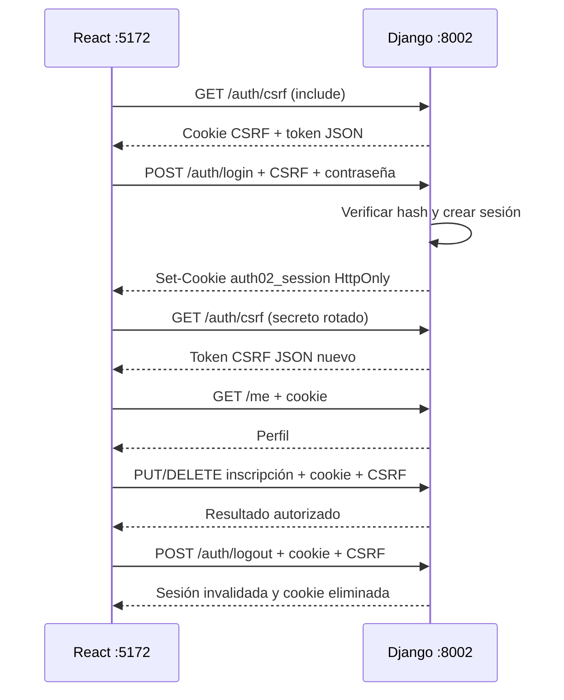

# 02 — Cookie de sesión con API y React

Ejemplo independiente de sesión Django consumida desde otro origen. La API conserva la sesión y el navegador su identificador en una cookie HttpOnly. React conserva únicamente datos visuales y el token CSRF en memoria: no almacena contraseñas, sesión ni perfil en localStorage/sessionStorage.

La interfaz tiene ingreso y registro separados; luego perfil, inscripciones propias, cancelación y catálogo con cupos. Cada archivo y componente es local a esta carpeta.

## Docker

Desde `02-cookie-sesion`:

```bash
docker compose up --build
```

Abrí **http://localhost:5172**. La API está en **http://localhost:8002**. Cuentas de clase: `demo@example.com` y `other@example.com`, contraseña `Demo12345!`.

El arranque migra y carga datos sin duplicar cuentas ni cambiar contraseñas existentes. SQLite persiste en el volumen propio `auth02-cookie-sesion_session-data`; React espera disponibilidad de la API. Django escucha en 8000 y Vite en 5173 dentro de Docker; el navegador usa los puertos publicados.

```bash
docker compose logs -f backend frontend
docker compose exec backend uv run --locked manage.py test activities
docker compose exec frontend pnpm build
docker compose exec frontend pnpm lint
docker compose down
```

**Bases anteriores:** antes de actualizar, detené el backend y respaldá SQLite (`backend/db.sqlite3` en local o `/data/db.sqlite3` en el volumen). La migración 0004 elimina las tablas ajenas `Token` y `ServiceKey`, **descartando sus datos**; conserva usuarios, actividades, inscripciones y sesiones Django. Las migraciones históricas 0001–0003 se mantienen sin reescribir. El arranque no borra toda la base.

El reinicio opcional `docker compose down --volumes` **elimina los datos de esta carpeta**. No forma parte del arranque habitual. Vite y `runserver` son servidores de desarrollo.

## Local con uv

Python 3.12 o posterior, uv, Node 22 y pnpm 11.10.0. `.python-version` selecciona Python 3.12; `uv.lock` fija dependencias y uv administra el entorno sin activación manual. Docker usa uv 0.12.19.

Desde `backend`, en una terminal:

```bash
uv sync --locked
uv run --locked manage.py migrate
uv run --locked manage.py seed_activities
uv run --locked manage.py runserver 0.0.0.0:8002
```

Desde `frontend`, en otra terminal:

```bash
pnpm install --frozen-lockfile
pnpm dev --port 5172 --strictPort
```

Usá `localhost` consistentemente. Compose funciona sin `.env`. Si cambiás puertos, copiá `.env.example` a `.env` y ajustá juntos `BACKEND_PORT`, `FRONTEND_PORT`, `VITE_API_BASE_URL`, `CORS_ALLOWED_ORIGINS` y `CSRF_TRUSTED_ORIGINS`. En local definí las variables en el entorno de cada proceso; Vite puede leer `frontend/.env`, Django no carga `.env` automáticamente. Si usás `127.0.0.1`, ajustá ambas URLs/listas de origen.

## Workflow general

1. **Inicialización:** React consulta `GET /api/v1/me` con `credentials: 'include'`. Si la cookie representa una sesión vigente, carga perfil, catálogo e inscripciones; si recibe 401 muestra ingreso. Nunca da por válida una identidad guardada en el navegador.
2. **CSRF:** antes de una escritura obtiene `GET /api/v1/auth/csrf`, que coloca `auth02_csrf` y devuelve `{csrfToken}` en JSON. El token se guarda en memoria y se envía como `X-CSRFToken`; no se lee `document.cookie`.
3. **Registro:** POST con nombre/email/contraseña, cookie CSRF y header. Django valida, crea usuario con contraseña hasheada y participante. React vuelve al ingreso, sin iniciar sesión implícita.
4. **Ingreso:** POST email/contraseña con CSRF. Django valida y crea/rota la sesión; el navegador recibe `auth02_session` HttpOnly. El login también rota el secreto CSRF: React vuelve a obtener un token JSON y después consulta `/me` e inscripciones.
5. **Uso:** las consultas envían cookie; PUT/DELETE de inscripciones agregan CSRF. Django resuelve usuario y luego verifica propiedad/cupo. La interfaz actualiza listas y cupos tras la respuesta y evita envíos duplicados.
6. **Recarga:** la cookie sigue disponible mientras no venza. React valida `/me` para recuperar datos; no necesita contraseña ni token de autenticación en JavaScript. Un 401 limpia datos privados; un 403 conserva identidad y muestra error. Si falló CSRF (por ejemplo otra pestaña rotó el secreto), la próxima acción obtiene un token nuevo; no se repite automáticamente una escritura.
7. **Salida:** POST con cookie y CSRF invalida la sesión en el servidor y elimina su cookie. React limpia datos privados y CSRF. Si la invalidación remota falla, limpia la interfaz y advierte que la cookie HttpOnly podría restaurar acceso al recargar: JavaScript no puede borrarla por su cuenta.



## Almacenamiento y duración

- **`auth02_session`:** cookie HttpOnly, `SameSite=Lax`, `Path=/`, sin Domain compartido y con `Max-Age=28800` (ocho horas). El servidor guarda la sesión Django; la cookie contiene un identificador, no la contraseña. HttpOnly impide leerla desde JavaScript.
- **`auth02_csrf`:** cookie HttpOnly, `SameSite=Lax`, `Path=/`; el frontend obtiene el token en JSON. El token CSRF no es una credencial de autenticación y puede estar en memoria JavaScript.
- **React:** guarda perfil/listas y CSRF solo en memoria. La contraseña se limpia del formulario después de ingresar o registrarse. No hay secretos ni perfiles persistidos en Web Storage.
- **Vencimiento:** al vencer la sesión, `GET /me` retorna 401; una escritura privada con CSRF válido también retorna 401; hace falta ingresar otra vez. No hay renovación por access/refresh. Una cookie con Max-Age no es simplemente una cookie que vence al cerrar el navegador.

En HTTP local `Secure=False` permite la práctica. Con `DJANGO_DEBUG=0`, ambas cookies usan Secure; fuera de desarrollo hace falta HTTPS, una clave secreta propia y configuración de despliegue adecuada. HttpOnly dificulta robar la cookie por XSS, pero un script malicioso todavía puede ejecutar acciones desde la página: no elimina XSS.

## CORS y CSRF

El puerto forma parte del origen: `localhost:5172` y `localhost:8002` son diferentes. Ambos siguen siendo el mismo sitio; usar dos puertos no exige `SameSite=None`. Cookies no se aíslan por puerto; nombres propios evitan pisar los otros ejemplos, sin convertir localhost en una frontera de seguridad entre aplicaciones.

Vite no tiene proxy y el navegador llama una URL absoluta de API. Todos los fetch usan **`credentials: 'include'`**. El backend permite solo `http://localhost:5172`, responde `Access-Control-Allow-Credentials: true` y admite headers `content-type`/`x-csrftoken`; OPTIONS no requiere sesión. Incluye CORS en errores, para leer 401/403 desde React.

`CSRF_TRUSTED_ORIGINS` autoriza ese origen para las escrituras, **sin sustituir el token CSRF**. Un Origin no confiable o un token ausente/inválido produce 403 aunque haya sesión válida. El ingreso, el registro y la salida también requieren CSRF.

Todas las escrituras usan **`CsrfViewMiddleware` nativo**, sin exenciones ni llamadas manuales al validador. `CSRF_FAILURE_VIEW` apunta a `csrf_failure`, que únicamente convierte el rechazo en JSON `{code: "csrf_failed", message: ...}` con estado 403.

El middleware comprueba CSRF **antes de ejecutar la vista**: sin token válido devuelve 403, incluso si falta la sesión. Con CSRF válido, una vista privada sin sesión devuelve 401. Las consultas GET privadas no requieren token CSRF y devuelven 401 si falta la sesión.

CORS y CSRF resuelven problemas distintos. Un origen no permitido no obtiene autorización CORS para leer una respuesta; eso no necesariamente cambia su estado HTTP. La validación de Origin de CSRF sí rechaza una escritura aunque el header contenga un token válido. Curl y los tests Django no aplican la política de lectura del navegador.

## Endpoints

| Método y ruta | Comportamiento |
| --- | --- |
| GET `/api/v1/activities` | Catálogo público con cupos |
| GET `/api/v1/activities/{activity_id}` | Actividad pública |
| GET `/api/v1/auth/csrf` | Público; cookie CSRF y `{csrfToken}` |
| POST `/api/v1/auth/register` | CSRF; `{name,email,password}` → 201, sin login implícito |
| POST `/api/v1/auth/login` | CSRF; `{email,password}` → sesión y perfil |
| POST `/api/v1/auth/logout` | Sesión + CSRF → 204 y cookie eliminada |
| GET `/api/v1/me` | Sesión → `{id,name,email}` |
| GET `/api/v1/me/enrollments` | Sesión → inscripciones propias |
| PUT `/api/v1/me/enrollments/{activity_id}` | Sesión + CSRF, sin body → 201 nueva, 200 existente, 409 sin cupo |
| DELETE `/api/v1/me/enrollments/{activity_id}` | Sesión + CSRF → 204 idempotente |
| DELETE `/api/v1/enrollments/{enrollment_id}` | Sesión + CSRF → 204 propia, 403 ajena, 404 inexistente |

Errores JSON `{code,message}`: `401 unauthorized` por acceso ausente/vencido; `403 csrf_failed` o `forbidden`; `400 invalid_request`; `409 email_taken`/`capacity_exhausted`; `404 activity_not_found`/`enrollment_not_found`. No hay challenge Basic. Las respuestas privadas usan `Cache-Control: no-store`.

Headers Authorization/API key no autentican. `/auth/refresh` y `/service/activities` no existen (404). Modelos activos: Activity, Participant, Enrollment, usuarios y sesiones Django.

SQLite es para desarrollo. `select_for_update` no bloquea filas en SQLite; para cupos concurrentes se requiere un motor con ese bloqueo y pruebas de concurrencia antes de desplegar.

## Mapa y consulta

| Archivo | Qué explica |
| --- | --- |
| [`backend/activities/api_views.py`](backend/activities/api_views.py) | Sesión, respuesta JSON al rechazo CSRF nativo, registro/login/logout, propiedad y cupos |
| [`backend/config/settings.py`](backend/config/settings.py) | Middleware CSRF nativo, CSRF_FAILURE_VIEW, CORS y atributos de cookies |
| [`backend/config/urls.py`](backend/config/urls.py) | Solo rutas del flujo de sesión |
| [`backend/activities/models.py`](backend/activities/models.py) | Dominio sin tokens o API keys |
| [`backend/activities/tests.py`](backend/activities/tests.py) | Sesión, rotación CSRF, Origin, CORS, permisos y cupos |
| [`frontend/src/api.ts`](frontend/src/api.ts) | URL absoluta, include, token JSON y errores HTTP |
| [`frontend/src/App.tsx`](frontend/src/App.tsx) | Formulario simple, restauración, perfil e inscripciones |
| [`compose.yaml`](compose.yaml) | Ejecución aislada y persistencia |

## Recorrido en el navegador

Abrí DevTools → Network y Application → Cookies.

- Registrá una cuenta: POST con CSRF, confirmación y retorno al ingreso.
- Ingresá: observá Set-Cookie y un GET de CSRF nuevo después del login.
- Comprobá que JavaScript no puede leer `auth02_session` ni `auth02_csrf`; no hay credenciales en localStorage/sessionStorage.
- Recargá: `/me` envía la cookie y valida antes de mostrar perfil.
- Inscribite y cancelá por actividad o por ID: cookie + X-CSRFToken, cupos/listas actualizados.
- Repetí una escritura sin token, o con uno obtenido antes del login: 403; identidad conservada.
- Con otro cliente/usuario intentá cancelar una inscripción ajena: 403, sin cerrar su sesión.
- Borrá o vencé la sesión: siguiente consulta privada devuelve 401 y limpia el área privada.
- Salí: POST protegido, sesión remota invalidada y cookie borrada; recargar mantiene el formulario.
- Simulá fallo de red al salir: el aviso distingue limpieza visual de invalidación remota no confirmada.
- Probá un origen no permitido: bloqueo CORS de lectura; una escritura con Origin no confiable también falla por CSRF.

Verificación local, desde backend: `uv run --locked manage.py test activities` y `uv run --locked manage.py makemigrations --check --dry-run`. Desde frontend: `pnpm build` y `pnpm lint`.

[Presentación: sesión entre orígenes](../autenticacion-seguridad-arquitecturas-web.html#sesion). Referencias: [sesiones Django](https://docs.djangoproject.com/en/5.2/topics/http/sessions/), [CSRF en Django](https://docs.djangoproject.com/en/5.2/ref/csrf/), [CORS en MDN](https://developer.mozilla.org/en-US/docs/Web/HTTP/Guides/CORS).

## Verificación de esta implementación

El 30/09/2026 se comprobaron arranque real y salud con Docker Compose, diez pruebas Django en local y Docker, coherencia de migraciones, build y lint del frontend Docker. Chrome real comprobó registro e ingreso, cookies HttpOnly de ocho horas, ausencia de secretos en Web Storage o Authorization, restauración tras recarga, CSRF ausente/anterior al login rechazado con 403, inscripción/cancelación propia, identidad conservada por 403 y recuperación del token CSRF en la próxima acción tras una rotación externa, limpieza por 401, salida remota y rechazo de una cookie copiada después del logout, aviso ante fallo de salida y restauración de esa sesión no invalidada. Se validó CORS en origen permitido y denegado, y se inspeccionaron vistas de escritorio y móvil.

Las comprobaciones corresponden al entorno de desarrollo; no son pruebas de despliegue productivo ni de cupos concurrentes en SQLite.
