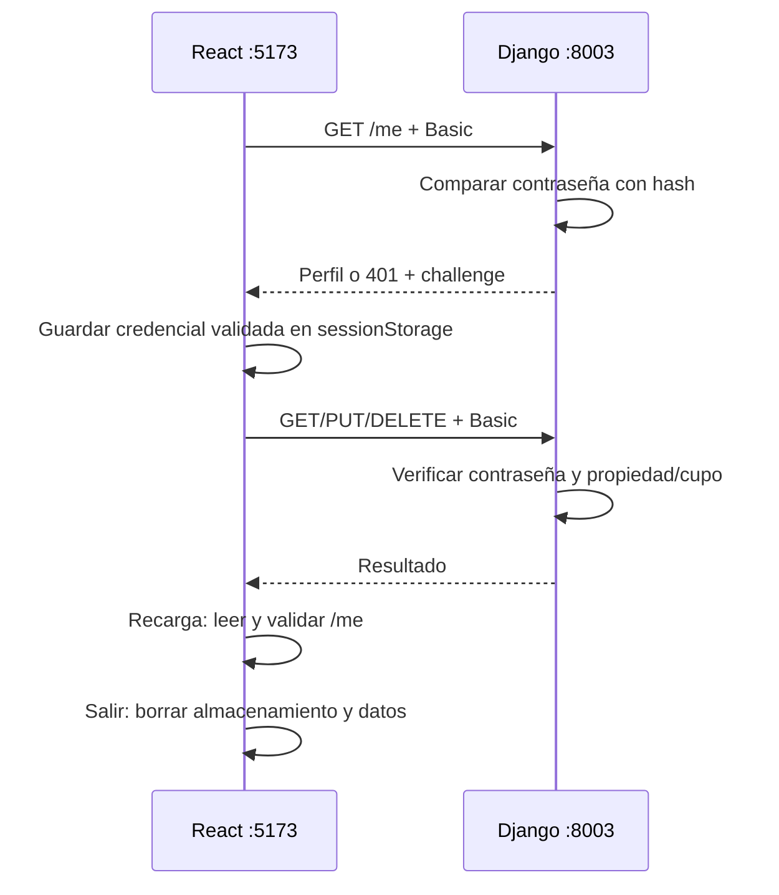

# 03 — HTTP Basic: credencial en cada petición

Esta carpeta es independiente. Django verifica email y contraseña mediante `Authorization: Basic <base64(email:contraseña)>` en **cada petición protegida**. No crea sesiones, no emite tokens y no tiene endpoints de login, logout, refresh ni CSRF. React y Django usan distintos orígenes; Vite no tiene proxy.

La interfaz ofrece ingreso/registro separados; después muestra perfil, inscripciones propias, cancelación y catálogo con cupos. Los componentes y funciones son locales a esta carpeta.

## Docker

Desde `03-http-basic`:

```bash
docker compose up --build
```

Abrí **http://localhost:5173**. La API está en **http://localhost:8003**. Cuentas de clase: `demo@example.com` y `other@example.com`, contraseña `Demo12345!`.

El backend migra y carga datos de forma idempotente. SQLite persiste en el volumen propio `auth03-http-basic_basic-data`; el frontend espera la disponibilidad de la API. No se cambian contraseñas existentes al arrancar.

```bash
docker compose logs -f backend frontend
docker compose exec backend uv run --locked manage.py test activities
docker compose exec frontend pnpm build
docker compose exec frontend pnpm lint
docker compose down
```

Antes de migrar una base anterior, detené el backend y respaldá su SQLite (`backend/db.sqlite3` en local o `/data/db.sqlite3` dentro del volumen). La nueva migración 0004 elimina las tablas ajenas `Token` y `ServiceKey`, **descartando sus datos**, pero conserva usuarios, actividades e inscripciones. Las migraciones históricas 0001–0003 permanecen sin reescribir. El arranque nunca elimina toda la base.

`docker compose down --volumes` es un reinicio opcional que **elimina los datos de esta carpeta**. No forma parte del arranque habitual. Los servidores `runserver` y Vite son para desarrollo.

## Local con uv

Python 3.12 o posterior; `.python-version` selecciona 3.12. Docker usa Python 3.12, uv 0.12.19 y Node 22; JavaScript usa pnpm 11.10.0. uv administra el entorno sin activación manual y `uv.lock` fija dependencias.

Terminal del backend, desde `backend`:

```bash
uv sync --locked
uv run --locked manage.py migrate
uv run --locked manage.py seed_activities
uv run --locked manage.py runserver 0.0.0.0:8003
```

Terminal del frontend, desde `frontend`:

```bash
pnpm install --frozen-lockfile
pnpm dev --port 5173 --strictPort
```

Compose funciona sin `.env`. Para cambiar puertos, copiá `.env.example` a `.env` y ajustá juntos `BACKEND_PORT`, `FRONTEND_PORT`, `VITE_API_BASE_URL` y `CORS_ALLOWED_ORIGINS`. En local configurá esas variables en el entorno de cada proceso; Vite también lee `frontend/.env`, Django no carga un `.env` automáticamente. Si cambiás `localhost` por `127.0.0.1`, ajustá ambas URLs/orígenes.

## Workflow y almacenamiento

1. **Registro:** POST público con `{name,email,password}` valida y crea usuario/perfil. Django guarda un hash de la contraseña. React vuelve al ingreso; no autentica implícitamente.
2. **Ingreso:** React codifica `email:contraseña` como Base64 UTF-8 y consulta `/api/v1/me` con Basic. Django verifica el hash. Una credencial fallida nunca se persiste.
3. **Continuidad:** después de validar, React guarda la credencial en memoria y `sessionStorage`, clave **`auth03_basic`**, y muestra los datos consultados al servidor.
4. **Operaciones:** cada consulta privada y cada inscripción/cancelación vuelve a enviar Basic. Se verifica contraseña y luego propiedad/cupo. La interfaz actualiza las listas después de la respuesta.
5. **Recarga:** lee storage y valida `/me` antes de mostrar identidad. Ante 401 borra credencial y datos privados; ante un problema de red informa el error sin asumir autenticación.
6. **Salida:** borra memoria, storage y datos privados, sin llamar al backend. La contraseña sigue siendo válida: **la salida local no revoca una copia**. Cambiar la contraseña o desactivar la cuenta invalida próximas peticiones.



`sessionStorage` conserva datos durante recargas de una pestaña. Duplicar o restaurar pestañas puede copiar/restaurar almacenamiento; cerrar una ventana no promete eliminación segura. Si la lectura o escritura falla, el frontend informa y permite ingresar en memoria. Si borrar falla, informa que podría quedar una copia restaurable.

**Base64 no cifra:** la contraseña es reversible y JavaScript puede leerla. XSS puede robarla. Esta decisión de continuidad de una SPA Basic no es una recomendación general para aplicaciones sensibles. No usar `localStorage` indefinido, URLs, logs ni variables públicas `VITE_*` para secretos. Limpiar el campo de contraseña no elimina la contraseña contenida en Base64. Fuera de la práctica local todo intercambio requiere HTTPS.

## Cliente HTTP controlado

[`backend/basic_client.py`](backend/basic_client.py) es una referencia de Basic sin frontend. Lee `BASIC_EMAIL`, `BASIC_PASSWORD` y opcionalmente `BASIC_API_URL` de configuración privada; consulta perfil e inscripciones sin imprimir secretos, guardarlos o aceptar redirecciones. Solo permite HTTP para localhost/loopback; fuera de desarrollo exige HTTPS.

Desde `backend`, ejemplo para Bash sin contraseña literal en el historial:

```bash
export BASIC_EMAIL=demo@example.com
read -rs -p 'Contraseña: ' BASIC_PASSWORD
export BASIC_PASSWORD
uv run --locked basic_client.py
unset BASIC_PASSWORD
```

La URL predeterminada es `http://localhost:8003`. En producción, obtener configuración del entorno privado o gestor de secretos. Un `.env` ignorado puede servir en desarrollo si tu herramienta lo carga; el script no lo carga automáticamente. No convertir `BASIC_PASSWORD` en una variable `VITE_*` ni versionar su valor.

## CORS y CSRF

Las llamadas usan URL absoluta a la API y **`credentials: 'omit'`**, sin cookies. `django-cors-headers` permite solo `http://localhost:5173`, métodos GET/POST/PUT/DELETE/OPTIONS y headers `authorization`/`content-type`; expone `WWW-Authenticate`. OPTIONS no exige credenciales y los errores también tienen CORS. No se permite `Access-Control-Allow-Credentials`.

Otro origen no recibe autorización CORS para leer la respuesta: el navegador bloquea su lectura. Esto no significa que el servidor devuelva 403. Los clientes de servicio no aplican CORS.

En **este flujo con header explícito** la aplicación no envía una credencial automáticamente y no usa middleware/token CSRF. **Basic gestionado automáticamente por el navegador requiere otro análisis CSRF**. CORS no es autorización del servidor ni defensa ante XSS. Dos puertos de localhost son distintos orígenes, pero siguen siendo el mismo sitio.

## Endpoints y errores

| Método/ruta | Contrato |
| --- | --- |
| GET `/api/v1/activities` | Público; catálogo con cupos |
| GET `/api/v1/activities/{activity_id}` | Público; una actividad |
| POST `/api/v1/auth/register` | Público; `{name,email,password}`; 201 nueva cuenta |
| GET `/api/v1/me` | Basic; perfil `{id,name,email}` |
| GET `/api/v1/me/enrollments` | Basic; inscripciones propias |
| PUT `/api/v1/me/enrollments/{activity_id}` | Basic sin body; 201 nueva, 200 existente, 409 sin cupo |
| DELETE `/api/v1/me/enrollments/{activity_id}` | Basic; 204 idempotente por persona/actividad |
| DELETE `/api/v1/enrollments/{enrollment_id}` | Basic; 204 propia, 403 ajena, 404 inexistente |

Error JSON: `{code,message}`. `401 unauthorized` incluye `WWW-Authenticate: Basic realm="Actividades", charset="UTF-8"`; elimina acceso. `403 forbidden` conserva identidad y muestra falta de permiso. `400 invalid_request`, `409 email_taken`, `409 capacity_exhausted`, `404 activity_not_found`/`enrollment_not_found` permiten distinguir fallos. Las respuestas privadas usan `Cache-Control: no-store`.

`/auth/login`, `/auth/logout`, `/auth/refresh`, `/auth/csrf` y `/service/activities` no existen (404). Cookies, Bearer y API keys no autentican.

SQLite es de desarrollo: `select_for_update` no bloquea filas en SQLite. Para alta concurrencia se necesita un motor con bloqueo y pruebas de cupos concurrentes antes de desplegar.

## Mapa de archivos

| Archivo | Funciones y propósito |
| --- | --- |
| [`backend/activities/api_views.py`](backend/activities/api_views.py) | `authenticate_request`, challenge, validaciones, propiedad y cupos |
| [`backend/activities/models.py`](backend/activities/models.py) | Solo Activity, Participant y Enrollment |
| [`backend/config/settings.py`](backend/config/settings.py) | CORS y ausencia de sesiones |
| [`backend/config/urls.py`](backend/config/urls.py) | Rutas de este ejemplo |
| [`backend/activities/tests.py`](backend/activities/tests.py) | Basic, reválida, aislamiento, CORS y dominio |
| [`frontend/src/api.ts`](frontend/src/api.ts) | Header Basic explícito y errores HTTP |
| [`frontend/src/credential.ts`](frontend/src/credential.ts) | Codificación y lectura/escritura/limpieza de storage |
| [`frontend/src/App.tsx`](frontend/src/App.tsx) | Restauración, ingreso/registro y área privada |
| [`backend/basic_client.py`](backend/basic_client.py) | Cliente controlado con configuración privada |
| [`compose.yaml`](compose.yaml) | Puertos, persistencia y disponibilidad |

## Recorrido en DevTools

Abrí Network y Application → Session Storage. No compartir capturas de credenciales reales.

- Registrá una cuenta y volvé al ingreso. Observá `/me` con Basic sin cookie ni endpoint login.
- Ingresá con contraseña incorrecta: 401 y ninguna credencial fallida guardada.
- Ingresá correctamente y recargá: `/me` valida antes de mostrar perfil.
- Inscribite/cancelá por actividad o por ID: cambian cupos y listas, con botones deshabilitados durante la operación.
- En otro cliente ingresá como otra persona e intentá borrar un ID ajeno: 403, sin perder identidad.
- Reemplazá `auth03_basic` por un valor inválido y recargá: 401 y limpieza.
- Cambiá contraseña o desactivá cuenta en el servidor: próxima petición falla.
- Simulá almacenamiento bloqueado: aviso y acceso en memoria. Si falla borrar, aviso de copia restaurable.
- Salí: desaparece la clave sin request logout; una copia de la contraseña sigue válida.
- Probá un origen no permitido: el navegador bloquea por CORS. Curl/tests Django no aplican esa política.

Verificaciones desde backend: `uv run --locked manage.py test activities` y `uv run --locked manage.py makemigrations --check --dry-run`. Desde frontend: `pnpm build` y `pnpm lint`.

[Presentación: HTTP Basic](../autenticacion-seguridad-arquitecturas-web.html#basic). Referencias: [RFC 7617](https://www.rfc-editor.org/rfc/rfc7617), [sessionStorage (MDN)](https://developer.mozilla.org/en-US/docs/Web/API/Window/sessionStorage), [almacenamiento y XSS (OWASP)](https://cheatsheetseries.owasp.org/cheatsheets/HTML5_Security_Cheat_Sheet.html).

## Verificación de esta implementación

El 30/09/2026 se verificaron: arranque y disponibilidad real con Docker Compose; ocho pruebas Django tanto locales como dentro de Docker; coherencia de migraciones; build y lint dentro del frontend Docker; cliente Basic contra la API local. Un recorrido automatizado con Chrome real comprobó registro, ingreso incorrecto sin persistencia, perfil, inscripción/cancelación, recarga, limpieza por 401, conservación de identidad por 403, salida local, errores de lectura/escritura/borrado de storage, ausencia de cookies y CORS permitido/denegado. También se inspeccionaron las vistas de escritorio y móvil.

Estas comprobaciones validan el recorrido de desarrollo. No son pruebas de despliegue productivo ni de concurrencia de cupos en SQLite.
