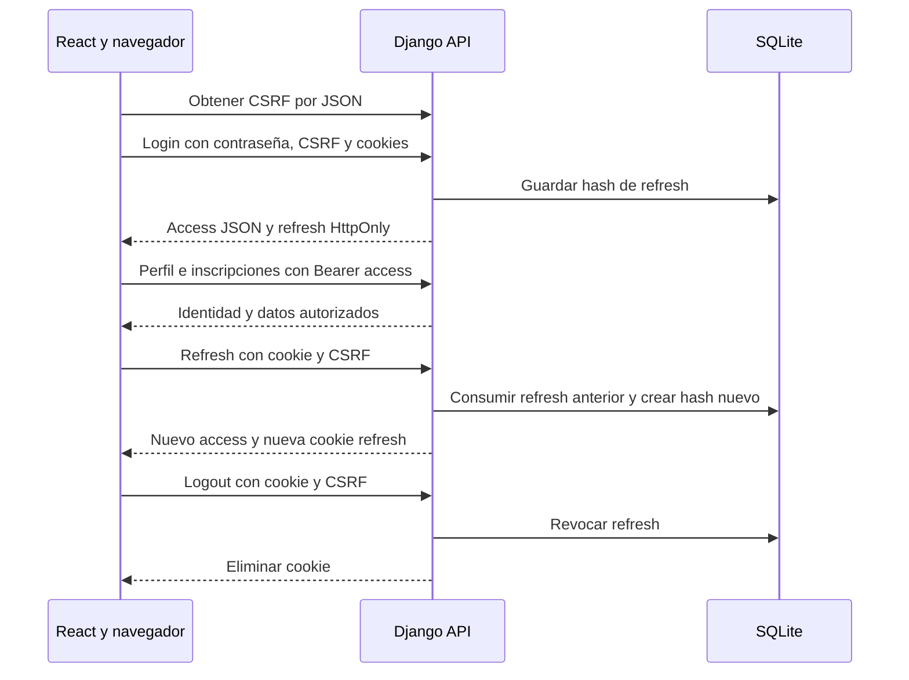

# 05 · Access JWT y refresh rotativo

Este ejemplo identifica personas con un **access JWT firmado enviado como Bearer**. React conserva el access en memoria. La continuidad después de una recarga depende de un **refresh opaco en cookie HttpOnly**, que se rota en cada renovación. No utiliza sesiones Django, HTTP Basic, access opacos ni API keys.

La interfaz ofrece ingreso y registro separados, perfil, inscripciones propias, catálogo con cupos y salida. Sus archivos pertenecen únicamente a esta carpeta. [Presentación: diagrama y explicación de JWT](../autenticacion-seguridad-arquitecturas-web.html#jwt).

## Arranque con Docker

Desde esta carpeta:

```bash
docker compose up --build
```

- Interfaz: <http://localhost:5175>.
- API: <http://localhost:8005/api/v1/activities>.
- Cuentas de clase: `demo@example.com` y `other@example.com`, contraseña `Demo12345!`.

El backend migra SQLite y carga actividades y cuentas de forma idempotente. El volumen `jwt-data` conserva la base al reiniciar y al ejecutar `docker compose down`. Un arranque repetido no cambia contraseñas ni emite refresh nuevos.

```bash
docker compose logs backend
docker compose exec backend uv run --locked manage.py test activities
docker compose exec frontend pnpm build
docker compose exec frontend pnpm lint
docker compose down
```

`docker compose down --volumes` **elimina todos los datos de esta carpeta**. Es un reinicio deliberado de la práctica, no un paso de arranque habitual.

Compose funciona sin crear `.env`. Para cambiar puertos, copiar `.env.example` a `.env` y modificar también `VITE_API_BASE_URL`, `CORS_ALLOWED_ORIGINS` y `CSRF_TRUSTED_ORIGINS`. El navegador necesita una URL `localhost`; `backend:8000` pertenece solamente a la red de Docker. No mezclar `localhost` con `127.0.0.1`.

## Ejecución local opcional

Requiere Python 3.12, uv, Node 22 y pnpm 11.10.0. Cada terminal comienza en esta carpeta.

```bash
cd backend
uv sync --locked
uv run --locked manage.py migrate
uv run --locked manage.py seed_activities
uv run --locked manage.py runserver 0.0.0.0:8005
```

En otra terminal:

```bash
cd frontend
pnpm install --frozen-lockfile
pnpm dev --host 0.0.0.0 --port 5175 --strictPort
```

`uv` administra `.venv` internamente; no se activa manualmente. Python y JavaScript tienen lockfiles propios. Vite no tiene un proxy `/api`: los requests se hacen directamente al puerto de la API.

## Workflow completo

1. **Registro:** nombre, email y contraseña crean usuario y participante. Django valida la contraseña y guarda su hash. No se emiten access ni refresh: la persona vuelve al ingreso.
2. **CSRF:** React consulta `GET /api/v1/auth/csrf` con `credentials: 'include'`. El JSON devuelve `csrfToken`; el navegador guarda `auth05_csrf` HttpOnly.
3. **Ingreso:** `POST /api/v1/auth/login` envía email, contraseña, `X-CSRFToken` y cookies con `include`. El servidor valida contraseña y CSRF, rota el secreto CSRF y devuelve `{access, token_type, expires_in, csrfToken}`. La respuesta establece `auth05_refresh` HttpOnly.
4. **Almacenamiento:** `api.ts` mantiene access y CSRF en memoria. El refresh solo vive en una cookie que JavaScript no puede leer. No se guarda contraseña, access ni refresh en `localStorage` o `sessionStorage`.
5. **Perfil e inscripciones:** `/me` valida el access antes de mostrar el área personal. Perfil e inscripciones usan `Authorization: Bearer <access>` y `credentials: 'omit'`. La cookie refresh por sí sola no autentica estas rutas.
6. **Validación:** PyJWT comprueba firma con `JWT_SIGNING_KEY`, algoritmo permitido `HS256`, emisor, vencimiento y claims obligatorios. El código exige tipos correctos y `type: 'access'`. `sub` identifica un usuario activo y el backend obtiene su participante.
7. **Operaciones:** inscribir y cancelar se autorizan para ese participante. La interfaz actualiza listas y cupos después de la respuesta. Un `403 forbidden` no cierra la identidad ni dispara refresh.
8. **Vencimiento:** ante `401` de una operación protegida, `accessRequest` renueva y reintenta **como máximo una vez**. `POST /auth/refresh` envía cookie y CSRF con `include`. El servidor consume el refresh anterior y entrega otro refresh más un access nuevo. Un valor consumido, vencido o de usuario inactivo produce `401`.
9. **Concurrencia:** `refreshAccess` comparte una promesa pendiente entre requests y efectos repetidos de React StrictMode. Una versión interna reconoce una renovación ya completada aunque dos JWT emitidos en el mismo segundo tengan el mismo texto. El servidor consume refresh mediante un `UPDATE` condicional como primera operación de la transacción, también en SQLite.
10. **Recarga:** la memoria empieza vacía. Se obtiene CSRF y se intenta refresh una sola vez; después `/me` valida el access obtenido. Solo entonces aparece el perfil. No se restaura identidad desde datos visuales guardados.
11. **Errores:** un refresh `401` o un fallo de conexión durante la renovación limpia access y datos privados. Un `403 csrf_failed` conserva la identidad existente, descarta el CSRF cacheado y deja que la próxima acción obtenga uno nuevo, sin repetir automáticamente la escritura. Esto permite recuperarse si otra pestaña rotó CSRF.
12. **Salida:** `POST /auth/logout`, cookie y CSRF revocan refresh y eliminan su cookie. La interfaz borra access y perfil. **Un access ya emitido puede seguir funcionando hasta `exp`**: no hay lista de revocación de access. Si logout falla, la interfaz informa que la limpieza fue local y que la cookie podría restaurar el acceso al recargar.



## Duraciones, almacenamiento y contexto

| Credencial | Lugar | Duración por defecto | Recarga y salida |
| --- | --- | --- | --- |
| Access | Memoria JavaScript | `ACCESS_SECONDS=60` | Se pierde al recargar. Logout limpia la copia local; la validez remota termina al vencer. |
| Refresh | Cookie HttpOnly `auth05_refresh` | `REFRESH_SECONDS=604800` (siete días) | Permite renovar tras recarga. Logout lo revoca y elimina su cookie. |
| CSRF | Cookie HttpOnly `auth05_csrf`; token JSON en memoria | Configuración Django | Se obtiene por JSON y se actualiza al rotar el secreto durante login. |

Refresh usa `Path=/api/v1/auth/` y `SameSite=Lax`. Es una cookie con `Max-Age`: cerrar pestaña o navegador no equivale a logout y puede conservarse hasta vencer. Path acota el envío, no es una frontera de seguridad.

Access en memoria reduce persistencia de secretos accesibles a JavaScript. HttpOnly evita leer refresh directamente, pero un XSS activo todavía puede usar access o ejecutar acciones. Elegir JWT no elimina XSS ni CSRF. Fuera de HTTP local se necesita HTTPS, `Secure` en cookies y claves privadas distintas de las de demostración. `JWT_SIGNING_KEY` es independiente de `DJANGO_SECRET_KEY`; producción exige una clave JWT configurada de al menos 32 bytes. Rotarla invalida access firmados con la clave anterior; revisar la política de refresh al efectuar ese cambio.

El payload contiene `sub`, `iat`, `exp`, `iss='untdf-demo'` y `type='access'`. No contiene contraseña ni `participant_id`. JWT firmado no es cifrado. Las fechas de emisión y vencimiento son segundos Unix.

## CORS y CSRF

Frontend y API usan orígenes distintos porque el puerto es parte del origen, aunque ambos `http://localhost` siguen perteneciendo al mismo sitio. Las cookies **no se aíslan por puerto**; los nombres `auth05_*` evitan sobrescribir otros ejemplos.

El backend permite únicamente `http://localhost:5175`, habilita credenciales CORS para cookies y atiende preflight `OPTIONS` sin autenticación. Respuestas de error también tienen CORS para ese origen. Un origen distinto falla al leer en el navegador: no implica necesariamente un HTTP `403`. `curl` no aplica la política CORS.

Django comprueba token y `Origin` en login, refresh y logout. `CSRF_TRUSTED_ORIGINS` no sustituye el token. Las escrituras de inscripciones autentican solo por Bearer explícito, omiten cookies y no requieren CSRF. Registro público no usa cookie de autenticación ni establece refresh. No imponer `SameSite=None` por usar dos puertos.

## Mapa de código

- [api_views.py](backend/activities/api_views.py): `make_access`, `access_user`, `issue_refresh`, `login_api`, `refresh_api`, `logout_api`, CSRF y autorización de inscripciones.
- [models.py](backend/activities/models.py): actividades, participantes, inscripciones y el único modelo de credenciales, `RefreshToken`.
- [settings.py](backend/config/settings.py): clave JWT, duraciones, nombres de cookies y orígenes autorizados.
- [api.ts](frontend/src/api.ts): `loadCsrf`, `login`, `refreshAccess`, `accessRequest`, `logout` y `clearAccess`. El estado access solo vive en este módulo.
- [App.tsx](frontend/src/App.tsx): restauración, formularios y datos privados de la persona actual.
- [tests.py](backend/activities/tests.py): firma/claims/expiración, CSRF, rotación/replay, límite de logout, propiedad y cupos.

## Endpoints y errores

| Ruta bajo `/api/v1` | Método | Credencial |
| --- | --- | --- |
| `/activities`, `/activities/{activity_id}` | GET | Público |
| `/auth/register` | POST JSON | Público, sin login implícito |
| `/auth/csrf` | GET | Cookie CSRF y token JSON |
| `/auth/login` | POST JSON | Contraseña y CSRF |
| `/auth/refresh`, `/auth/logout` | POST | Cookie refresh y CSRF |
| `/me`, `/me/enrollments` | GET | Bearer access |
| `/me/enrollments/{activity_id}` | PUT / DELETE | Bearer access, usuario actual |
| `/enrollments/{enrollment_id}` | DELETE | Bearer access y propietario |

`PUT` no recibe body y es idempotente: primera inscripción `201`, repetición `200`. Cancelar por actividad es idempotente (`204`) y solo afecta al usuario actual. El caso de propiedad ajena se demuestra con el segundo endpoint, por **ID de inscripción**, que devuelve `403 forbidden`.

Errores JSON: `401 unauthorized`, `403 csrf_failed` o `forbidden`, `409 capacity_exhausted` o `email_taken`, `400 invalid_request`, `404 activity_not_found` o `enrollment_not_found`. El endpoint de servicio no existe. Los requests a rutas inexistentes reciben `404` de Django. La base guarda únicamente hashes de refresh; ningún endpoint devuelve el secreto refresh por JSON.

## Recorrido de DevTools y fallos provocables

1. Ingresar y revisar Network: `/csrf`, `/login`, `/me` y lista de inscripciones. Observar dos puertos y un preflight cuando corresponda.
2. En Application verificar refresh y CSRF HttpOnly, ausencia de secretos en Web Storage y Path/Max-Age. `document.cookie` no permite leerlos.
3. Inscribirse y cancelar: observar Bearer en cada request de dominio, sin cookie refresh. Recargar y observar un refresh antes de `/me`.
4. Esperar un minuto, o configurar `ACCESS_SECONDS=5` antes del arranque: la próxima operación renueva y se reintenta una vez.
5. Reenviar refresh sin `X-CSRFToken`: `403 csrf_failed`. No publicar el valor real de cookies, Authorization ni contraseñas en capturas o informes.
6. Guardar un refresh para la prueba controlada, renovarlo y reenviar el anterior: `401`. Dos POST simultáneos con el mismo valor solo permiten una renovación.
7. Alterar firma o claims del access: `401`. Desactivar la cuenta rechaza access y refresh.
8. Usar dos cuentas y el ID de inscripción de la otra persona: `403 forbidden`. Un DELETE bajo `/me` nunca cancela a la otra cuenta.
9. Salir: refresh deja de renovar. Una copia de access vigente aún permite `/me` hasta vencer.
10. Abrir la interfaz como `http://127.0.0.1:5175`: el origen no permitido provoca fallo CORS de lectura. Volver a `localhost`.

## Bases existentes y migración

Conservar una copia de la base anterior **antes** de actualizar. La migración `0004_refresh_isolation` sigue el historial existente: preserva cuentas, hashes de contraseña, participantes, actividades e inscripciones, retira `ServiceKey` y tokens que no eran refresh, renombra `Token` a `RefreshToken` y elimina `kind`. El código activo solo utiliza refresh opacos y JWT access.

El nombre de cookie cambia a `auth05_refresh` y la clave de firma es propia del ejemplo. Tras actualizar, ingresar nuevamente. Una copia antigua de `db.sqlite3` no se importa al volumen Docker automáticamente; ubicar su copia en `/data/db.sqlite3` del volumen antes de migrar si se quiere conservar ese historial. No sobrescribir una base en uso ni ejecutar `down --volumes` para actualizarla.

## Verificación realizada

Suite Django específica de 12 pruebas, comprobación de migraciones y build/lint React. Docker se construyó y arrancó desde base nueva con API y frontend en puertos distintos. El recorrido en Chrome verifica cookies, ausencia de Web Storage, restauración, inscripción/cancelación, renovación compartida y reintento, CSRF, logout y CORS real. Los resultados generales de la entrega se registran en [VERIFICACION.md](../VERIFICACION.md).

Referencias: [PyJWT](https://pyjwt.readthedocs.io/en/stable/usage.html), [CSRF Django](https://docs.djangoproject.com/en/5.2/ref/csrf/) y [atributos de cookies](https://developer.mozilla.org/en-US/docs/Web/HTTP/Reference/Headers/Set-Cookie).
